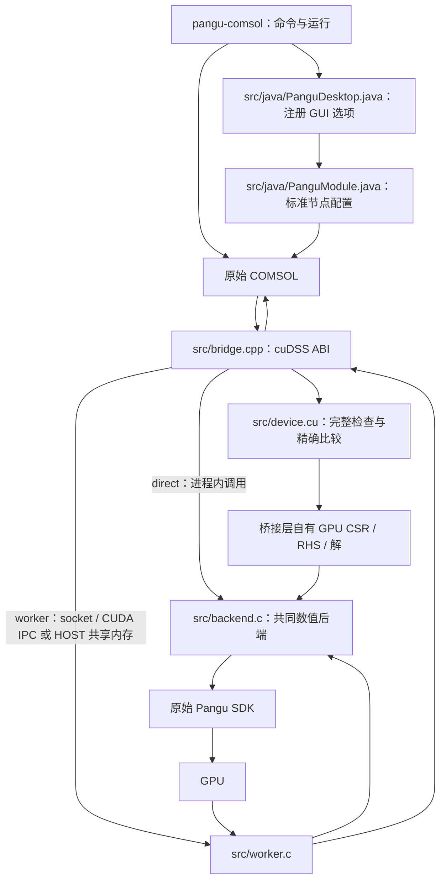

# 接入结构

统一入口为可安装的 `pangu-comsol` 终端应用，无参数进入交互界面，保留子命令。`start.sh` 是 GUI 快捷入口，转交 `pangu-comsol run`；批处理、配置、SDK 包和许可管理使用同一 CLI。

## 源码阅读顺序

核心分为三层。CLI 与 Python 运行层准备本次运行；Java 代码把模型的线性求解器连接到 cuDSS 槽位；C/C++ 代码实现这个槽位并调用 Pangu。

| 层 | 从哪个文件看起 | 关键入口 |
|---|---|---|
| 终端界面 | `src/python/pangulu_comsol/tui.py` | 页面、后台操作、错误反馈与取消 |
| 安装与数据目录 | `paths.py`、`pyproject.toml`、`setup.py` | 标准命令入口、独立数据目录、正式构建资源 |
| 命令与管理 | `src/python/pangulu_comsol/cli.py` | `init`、`config`、`package`、`license` |
| 可选测试入口 | `src/python/pangulu_comsol/testing.py` | 独立校准组件的构建、校验、后端环境和可选验收工具调度 |
| 运行与构建 | `src/python/pangulu_comsol/runtime.py` | `launch`、`comsol_command`、`clean_env`、`build` |
| GUI 选项 | `src/java/PanguDesktop.java` | `start`、空闲时的 `tick` |
| 模型配置 | `src/java/PanguModule.java` | `targets`、`registerAll`、`apply`、`restore` |
| cuDSS ABI | `src/bridge.cpp` | `cudssExecute`、矩阵暂存、`start_worker` / `rpc` |
| GPU 输入检查 | `src/device.cu` | `stage_offsets`、`stage_entries`、`check_finite` |
| Pangu 数值后端 | `src/backend.c` | `load_matrix`、`initialize_analysis`、`factor`、`phase`、`pc_backend_dispatch` |
| worker 通信 | `src/worker.c` | socket 接收、共享内存映射和后端生命周期 |

`pangu/` 保存原始厂商 SDK，`licence/` 保存独立许可，`runtime/` 保存编译组件和运行依赖。安装时程序代码与这些可变运行文件分开。默认数据目录使用 XDG 用户数据位置，`--home` 可指定已有目录。正式 C/C++、Java 构建资源随 Python 应用安装，源码目录移走后仍可构建运行组件。

## 一次求解的调用路径

1. Python 运行层读取 `config/runtime.json`，解析活动 SDK，在 `data/runs/` 建立自身记录与许可快照；COMSOL 偏好、临时和恢复路径继承默认或用户已有设置。
2. COMSOL 的 `-cudssroot` 指向本模块 `runtime/module/`，从那里加载 `libcudss.so.0.7.1`。
3. GUI 的 `PanguDesktop` 在空闲时用 `PanguModule.registerAll` 为所有兼容求解器操作添加标准 Direct 选项，保留原来的选择和已有解。用户在 Linear solver 中选择 Pangu 后使用 `cudss` 槽位。批处理则用 `PanguModule.apply` 显式选择指定节点。
4. COMSOL 组装稀疏矩阵后调用 cuDSS 接口。`src/bridge.cpp` 接收这些调用，检查 CSR、标量类型、结构和求解阶段。
5. 有序且无重复的 GPU CSR 由 CUDA 核心完整检查、归一化并复制到桥接层自己的 GPU 快照。默认 worker 模式通过 Unix socket 发送命令和 CUDA IPC 句柄；direct 在进程内使用同一快照。HOST、混合内存及无序 CSR 保留 HOST 规范化路径。
6. 两种模式共用 `libpangu_backend.so`。GPU 快照直接以 CSR/DEVICE 交给 Pangu；HOST 回退路径转换为 CSC/HOST。后端通过厂商公共 C API 调用分析、分解、重分解和回代。
7. GPU 路径在独立的设备缓冲区传递 RHS 和解，HOST 路径使用原暂存区。完成数值阶段后检查解的有限性，再复制回调用者；COMSOL 继续外层迭代、时间步和物理场恢复。

## 文件分工

| 文件 | 作用 |
|---|---|
| `pangu-comsol`、`src/python/pangulu_comsol/` | 初始化配置、本地 SDK 包管理、原始许可文件管理、构建和启动 |
| `src/java/PanguModule.java` | 模型检查、消费者选择、启用/恢复求解器 |
| `src/java/PanguDesktop.java` | 本会话的全局选项注册、GUI 空闲检测和状态记录 |
| `src/java/PanguBatch.java` | COMSOL batch 入口 |
| `src/bridge.cpp` | cuDSS ABI、矩阵检查、进程间传输 |
| `src/device.cu`、`src/device.h` | GPU 偏移/索引校验、逐元素快照比较和输出有限性检查 |
| `src/backend.c`、`src/backend.h` | 两种执行方式共用的矩阵转换、求解状态及原始 Pangu API 调用 |
| `src/worker.c` | 独立进程的通信、内存映射和后端生命周期 |
| `src/protocol.h` | 命令、HOST/DEVICE/IPC 传输和内容版本 |
| `src/pattern_cache.h` | 稀疏结构转换和缓存检查 |
| `src/native_license.c` | 原生 SDK / GPU / 许可检查 |

## GPU 快照和生命周期

`cudssDataCreate` 同步建立数据对象所拥有的数值后端及一个真实、尚未绑定矩阵的 Pangu handle；worker 在这里启动并完成初始化握手。首次 `cudssExecute` 消费这个 handle，不提前读取矩阵或执行分析。没有执行过矩阵操作的数据对象也会在析构时释放 handle、关闭 worker。后续需要重建分析时，继续使用原有销毁/新建语义，不能复用旧结构的分析结果。

原生 Pangu 调用者同样先创建 handle，再进行分析。因此阶段对照需要对齐这一生命周期，并单独记录 Create/DataCreate 和完整冷启动时间。初始化位置的调整本身不代表减少了总工作；矩阵快照、内容检查、IPC 导入和 Pangu 分析仍计入 Execute。

每次分析或分解都读取实际的调用者数组，不能仅凭 descriptor、设备指针或尺寸重用结构。偏移核先检查完整边界、单调性和可选 ends 连续性；后续核才读取索引及数值。32/64 位索引与零/一起始索引归一化为 32 位 CSR。每一个偏移、索引和 64 位数值字都与上一次自有快照精确比较；结构和数值分别使用递增 epoch，没有哈希相等判断。所有准备和比较仍包含在对应 `cudssExecute` 调用内。

结构变化会释放旧 Pangu 分析状态并重新分析。L2 允许相同结构更新数值后重分解；未请求 L2 时保留原有的重新分析规则。无序 CSR 回到 HOST 的严格规范化路径，重复位置会被拒绝。DEVICE 与 managed 输入只作为复制源，调用者的子分配和偏移地址不会被导出，也不会被数值后端改写。

worker 只打开桥接层 `cudaMalloc` 分配的 CUDA IPC 句柄，不使用另一进程的裸地址。矩阵和 dense 缓冲区分别增长；旧分配保留到后端成功切换后才释放。关闭时先销毁 Pangu 描述符/句柄并关闭 IPC 映射，等待 worker 退出，然后释放导出端内存。CUDA IPC 导出不可用会选择 HOST 路径；导入失败返回真实 CUDA 错误，不自动重复任何数值阶段。

RHS 的设备复制完成后才通知数值后端，因为两个进程的 CUDA stream 不共享顺序。后端同步求解完成后响应；桥接层检查输出有限性，完成向调用者的复制后返回。正常数值失败直接上报，不执行隐藏的重新分解、精化或阈值放宽。

`device.cu` 仅链接到 cuDSS 适配库，两种数值后端均使用原始 SDK。构建可通过 `PC_CUDA_COMPILER` 和 `NVCC_CCBIN` 指定 CUDA 12 工具链；sm75/sm80 机器码和 compute75 PTX 覆盖计算能力 7.5 及以上 GPU，更早设备选择 HOST 路径。清单的 `device_csr`、`device_min_compute_capability` 和运行日志记录实际启用状态。只有 gcc/g++ 时仍能构建明确标识的 HOST 回退版本。

## 边界

COMSOL 的物理场、网格、组装、外层非线性迭代、时间步和后处理继续由 COMSOL 完成。替换发生在线性直接求解后端。

适配库覆盖经过验证的 cuDSS 调用子集。参数被接收不代表所有 cuDSS 数值策略都已映射；真实配置及诊断限制见 [使用说明](usage.md) 的适配范围。

SDK 完整原件放在 `pangu/` 下唯一发行目录，许可放在根目录 `licence/`，生产组件在 `runtime/module/`。更新直接替换整套 SDK，启动器按实际文件和 ABI 识别，不使用版本登记或 current 链接。原始 SDK、配套库及签名许可保持字节不变。正式构建仅编译 src/，不依赖内部测试工具。

桌面扩展在当前进程的原始插件启动列表后追加 Pangu，不写 COMSOL 安装或用户偏好，不改工作区和插件配置目录。后续普通启动使用原始列表，附加初始模块由 Equinox 启动机制移除；缺少会话标记时 Pangu 扩展也不会注册选项。命令行指定的 GUI 输入先复制为会话工作模型；桌面注册不保存模型。GUI 内直接打开原文件后手动保存，仍会把新增标准节点写入该文件。普通 COMSOL 能读取这些节点，CPU 求解器引用保留；cuDSS 在同一 Pangu 会话内整体映射到适配库，要使用 NVIDIA 原生 cuDSS 应另开原生会话。

## 运行记录

模组自身的记录放在 `data/runs/comsol_<时间戳>/`，`session.json` 保存后端、实际库路径、SDK 与许可哈希以及启动参数。模型工作副本和批处理输出按命令指定的位置保存。COMSOL 自身的偏好、缓存、临时与恢复文件仍按默认或用户已有设置管理。

终端页面通过独立子进程调用同一 CLI，不在界面线程执行 GPU 检查、解压或编译。COMSOL GUI 使用独立进程和会话日志，终端界面退出不依赖管道维持 GUI。

可选 `test` 入口提供原生 cuDSS、直接转发和独立 worker 转发三个选择；测试数值核心均为原生 NVIDIA cuDSS。测试封装与内部 S 验收代码在单独提供的工具集中，本机位于忽略的 `dev/benchmarks/mycudss/`。`runtime/tests/mycudss/` 保存独立组件及原生库/构建产物哈希，生产 Pangu 组件继续位于 `runtime/module/`。

Pangu 的 `--execution worker/direct` 与上述 NVIDIA 校准后端独立，测试页也提供 Pangu 及其执行方式。direct 通过 `dlopen` 在 COMSOL 进程中加载共同后端；不启动 worker。直接模式的启动兼容逻辑位于 `execution.py`，从当前厂商启动器生成仅省略 libjsig 的私有脚本；不写 COMSOL 安装或用户偏好。两种模式共用相同的数值和缓存策略。
